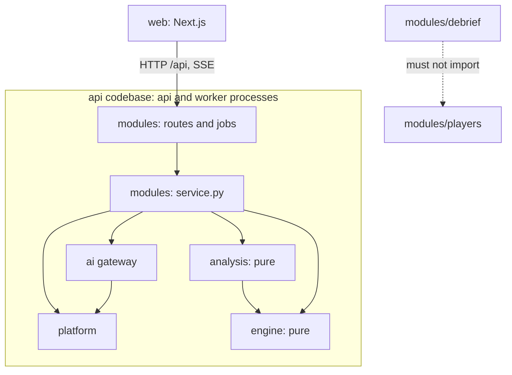
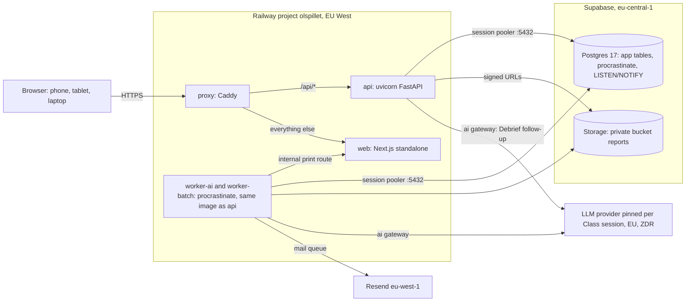

# Architecture Spine — ØL-spillet v1

## Design Paradigm

**Modular monolith with a functional core and an imperative shell.** One Python codebase runs as three processes (`api`, `worker-ai`, `worker-batch`). A Next.js app renders the UI. The core, `engine` and `analysis`, is pure: no I/O, no clock, no randomness without a passed seed. Everything else is the shell around it.

| Layer | Path | Holds | May import |
| --- | --- | --- | --- |
| Engine (pure) | `api/app/engine/` | Game settings model, Week advance, demand series, Rule-based player, near-optimal reference, conservation check | stdlib, pydantic |
| Analysis (pure) | `api/app/analysis/` | Computed facts, Detected patterns, Order amplification, Play guard statistics, completion rules, SM metrics | engine |
| Modules (shell) | `api/app/modules/<slice>/` | Routes, services, repositories, jobs per vertical slice | engine, analysis, ai, platform, other modules' `service.py` only |
| AI gateway | `api/app/ai/` | The only LLM boundary, prompts, schemas, mock provider | platform |
| Platform | `api/app/platform/` | db, config, auth, authz, events (NOTIFY/SSE), jobs, email, storage, audit | stdlib, third-party |
| Web | `web/` | Next.js presentation only | api over HTTP |



## Invariants & Rules

### AD-1 — The engine is pure and owns all game arithmetic

- **Binds:** FR-11, FR-12, FR-13, FR-23, FR-26, FR-28, FR-29, FR-31, FR-33, FR-79, NFR-9; `engine`, `analysis`, `web`
- **Prevents:** inventory, backlog, cost or Supply line computed in two places (route, job, frontend) and disagreeing.
- **Rule:** Week advance is `engine.advance(settings, state, orders) -> state` and follows the PRD FR-26 sequence exactly. `engine` and `analysis` do no I/O and read no clock. Randomness comes only from a seed you pass in. No other code computes game quantities: the frontend displays what the API returns, and jobs call the engine. The Rule-based player, the near-optimal reference and the Play guard statistics are pure functions here too. Their parameters stay open until issues #8 and #20 settle them.

### AD-2 — Game state has one write path

- **Binds:** FR-20 to FR-22, FR-24 to FR-28, FR-30, FR-32, FR-36 to FR-39, FR-48, FR-87, FR-89, NFR-4; `modules/games`, `modules/players`, sweeper
- **Prevents:** a Week advancing twice, or not at all, when the last human and an AI player order at the same moment. Also prevents Takeover, Pause or playout logic forking between the API, AI jobs and the sweeper, and a late human Order and an AI Order each "succeeding" for the same Seat.
- **Rule:**
  - Only `games.commands` creates or mutates a Game, its Seats, occupancy, turns (AD-20) and Week states. The commands are `create`, `assign_seat`, `move_seat`, `start`, `view_week`, `place_order`, `takeover`, `request_reclaim`, `pause`, `resume`, `set_agreed_time`, `mark_in_room`, `playout`, `switch_to_rule_based`, `finish`. A new command is added here, never beside it.
  - Each command is one DB transaction that first runs `SELECT … FOR UPDATE` on the Game row, increments the Game's `version`, and emits the change event (AD-8) in the same transaction.
  - Clients never send an expected `version`. `place_order` checks that the Week is the open Week and that the caller is the Seat's current occupant. It answers `409 order_exists` or `409 seat_not_yours` otherwise, and a confirmed Order is never updated. The unique key `(game_id, week, seat_id)` backs this up.
  - One predicate, `games.rules.week_complete(game)`, decides the advance: every Seat has an Order for the open Week, and in a Guided Week every Student occupant has also viewed it (FR-24). The command that makes it true advances **exactly one** Week in its transaction and opens the next.
  - A Game stores `lifecycle ∈ {not_started, running, playing_out, finished}` and, apart from it, the Pause columns `paused_at`, `paused_by` and `resume_at`. Only `pause`, `resume`, `place_order` and `playout` write the Pause columns. A `place_order` by a Student clears them in the same transaction, whoever started the Pause (FR-89). The displayed status (FR-39) comes only from `games.rules.game_status(game, turns)`, and `game_summaries` (AD-25) stores its result.
  - Human requests, AI jobs, the sweeper and staff actions all call these commands; none writes the game tables directly.
  - `playout` runs once per Game at the Play deadline, where `games.policy` applies it (AD-13). It sets `lifecycle = playing_out`, clears any Pause, drops queued Reclaims, and appends an AI occupant with reason `playout` to every Seat a Student holds (AD-5). After it, `place_order`, `pause`, `takeover` and `request_reclaim` from a person answer `409 play_deadline_passed`. An Order committed before `playout` stands. The Game row lock settles the race.

### AD-3 — The Seat state is the single information boundary

- **Binds:** FR-14, FR-23, FR-25, FR-31, FR-39, FR-62, FR-83, FR-84, FR-67 (state seen), PRD §6.1
- **Prevents:** the API leaking the number of Weeks, the demand series or another Seat's state to a Student. Also prevents an AI player getting different numbers than a Student in the same Seat, and Student names reaching the LLM or the Decision log.
- **Rule:**
  - `games.views.seat_state(game, seat, week)` returns **numbers only**: the FR-23 values, the Posisjon, the neighbour numbers Information visibility allows, and Roles. It never holds names, the number of Weeks or future demand. The Student's play screen shows it, the LLM player's prompt is built only from it, and the Decision log stores it as `state_seen`.
  - `seat_state` is one Pydantic model, `games.schemas.SeatState`, with a `schema_version`. Its minimum fields are fixed before the first player story: Week; Role; inventory; backlog; incoming order; incoming delivery; units shipped; Supply line slots with arrival Weeks; Posisjon; running Total cost with this Week's cost lines; the Seat's own history of Orders and Week values; neighbour numbers with their Role and Week; the Order limits; and the preview coefficients (AD-10). The play screen, the prompt builder and the simulation runner all read this model, and a field is added to it, never beside it.
  - `games.views.table_status(game, viewer)` returns the **people** side: who occupies each Seat (name or «KI-spiller»), who has ordered, wait times, Pause and Takeover times. Names are resolved at read time. It is never stored and never sent to an LLM.
  - The play endpoint returns both in one envelope, with `server_now` and `next_change_at` (AD-20).
  - Full-chain data, the demand series and the number of Weeks are served only by Debrief, insight and staff endpoints. Staff may see running Games through AD-12 scope. Students get them only past the Debrief gates (FR-42, FR-43).

### AD-4 — Settings freeze at the Start-date lock, and a Game is replayable

- **Binds:** FR-12, FR-13, FR-15, FR-18 lock points, FR-20, FR-29, FR-49, FR-66 to FR-68, FR-78, FR-87
- **Prevents:** Games allocated a week early running on settings the Lecturer later changed, a running Game changing behaviour when the Class session is edited, and an old Game that cannot be recomputed after a rules change.
- **Rule:**
  - Allocation creates Games and Seats **without** settings. `sessions.lock`, run at the Start date (by the sweeper or when the Lecturer starts early), freezes the Class session and writes to every Class game the same snapshot: `GameSettings` (the `engine` model, JSONB with `schema_version`), the materialised demand series with its seed, the engine `rules_version`, and `SessionRuntime` (AI mode, Effort level, Inactivity limit, pinned model config, prompt versions, content versions per AD-23).
  - Replays, make-ups, Lecturer test Games and simulation Games take their snapshot when they are created.
  - A Game reads only its snapshot. The only live reads are the Class session's deadlines, its cost-limit state (AD-6) and per-Student adjustments (FR-17).
  - The finished-game check (FR-29) replays the engine at the stored `rules_version` over the stored Orders and must reproduce the stored Week states.

### AD-5 — Occupants are interchangeable behind one order source

- **Binds:** FR-15, FR-30 to FR-38, FR-69, FR-78, FR-79, FR-89, NFR-2, NFR-4
- **Prevents:** a separate code path for each of Takeover, Reclaim, Guided Weeks, fallback, Play guard switch, cost-limit switch and playout, and an AI Seat left with no Order.
- **Rule:**
  - Every Seat has an occupancy history `(seat_id, from_week, occupant_kind ∈ {student, llm, rule_based, scripted}, reason ∈ {initial, takeover_inactivity, takeover_staff, takeover_peer, reclaim, guard_switch, cost_limit, playout})`. Takeover, Reclaim, the Play guard switch, the cost-limit switch and playout only append to it. `scripted` exists only in simulation Games (AD-22).
  - One function, `players.ensure_order(game, seat)`, is called whenever a Seat without an Order has a non-student occupant: when a Week opens **and** right after a mid-Week Takeover or switch. For Guided Weeks, `rule_based` and `scripted` occupants it places the Order in the same transaction. For `llm` it defers one `ai-orders` job keyed `(game, week, seat)` on the same database connection, so the job commits with the Week or not at all.
  - The job calls the AI gateway **once**; the gateway owns attempts and the deadline (AD-6). On a typed failure the job places the stored Rule-based reference Order with `decided_by = rule_based` and `fallback` set to the failure type (AD-15). Otherwise it calls `place_order` with the LLM Order. The job never runs the Play guard. The Order's deadline counts from the turn's `opened_at` (AD-20), or from the Takeover if that came later.
  - The Rule-based and near-optimal reference Orders are computed once per Seat when the Week opens, in that transaction, and stored on the `seat_turns` row (AD-20). `place_order` copies them into `seat_week` and never recomputes them. For an Order with `decided_by = llm`, `place_order` runs the Play guard (pure) over the Seat's stored `seat_week` rows plus the new one, in the same transaction. When the guard switches, `place_order` appends the occupancy row with `from_week = week + 1` in that transaction.
  - The `worker-ai` process runs a rescue loop every 5 seconds that places the fallback Order for any `llm` turn past its deadline. The minute sweeper is not the safety net for AI Orders.
  - A playout Order has no Order deadline (FR-32). For a Game in `playing_out`, `ensure_order` defers the `llm` job to `llm-batch`, not `ai-orders`, and sets no `ai_deadline_at`, so the rescue loop skips the turn. The gateway's attempt limit and per-attempt timeout still apply, and a typed failure still gives the Rule-based Order. The sweeper re-enqueues a playout turn that has no Order and no live job.
  - A Play guard switch is permanent for that Seat in that Game (FR-79). A cost-limit switch applies `switch_to_rule_based(reason=cost_limit)` to every `llm` Seat of the Class session (FR-69). It holds for the rest of the Class session. While the cost-limit state is set (AD-6), every new occupancy that would be `llm` is created as `rule_based` with reason `cost_limit`. This covers Replays, make-ups, Takeovers and playout. An `ai-orders` job already running gets `budget_exhausted` and places the fallback Order.

### AD-6 — The AI gateway is the only LLM boundary

- **Binds:** FR-31, FR-32, FR-34, FR-44, FR-45, FR-50, FR-53, FR-54, FR-67 to FR-69, NFR-2, NFR-3, NFR-8, PRD §6.1, §6.3
- **Prevents:** an LLM call that skips model pinning, the PII filter, budget limits, rate limits or cost logging. Also prevents retries multiplying between a job and the gateway, and vendor SDKs spreading across modules.
- **Rule:**
  - Only `app/ai` imports `pydantic-ai` or any provider SDK, and only `app/ai` owns the model config, budget and `llm_call` tables. Every call is `ai.run(purpose, budget_scope, inputs, output_schema, deadline)`. `budget_scope` is a Class session or an evaluation budget (AD-22). A Control test is a Class session (AD-27) and uses its budget. A call without a Class session uses an evaluation budget, so every call has a model config and a budget row. Callers never pass a model, a prompt version or scrub terms. It returns a validated result or a typed failure (`timeout`, `invalid_output`, `budget_exhausted`, `provider_error`). Callers never retry.
  - Inside one call the gateway does all of this:
    1. It resolves the scope's pinned model config by id, and the prompt version for the purpose from that config's `prompts` map. There is no automatic router or provider fallback (FR-68). A retired or failing endpoint gives typed failures, never another model.
    2. It reserves each attempt's worst-case cost (max tokens × price) on the scope's one budget row with a single conditional `UPDATE`, and settles to the actual cost after the attempt. No limit check sums `llm_call` rows. The row holds `limit`, `reserve`, `spent` and `players_exhausted_at`. Player purposes may not spend `reserve`; Debrief and AI assessment may. When a player reservation fails, the gateway sets `players_exhausted_at`, which is the cost-limit state, and returns `budget_exhausted`. `players` then applies the cost-limit switch (AD-5) and the Lecturer notice (FR-69).
    3. It scrubs every free-text input against the Roster's names, emails and student numbers, and returns with the result an offset map from each scrubbed text to its original. The terms come from `platform/pii.terms(class_session_id)`, a read-only query over the `identity` tables that only the gateway calls. Structured inputs carry Roles and pseudonymous ids only.
    4. It waits on a per-endpoint rate limiter sized from the provider's confirmed limit, and treats HTTP 429 as back-off inside the deadline, not as a failure (NFR-3).
    5. It makes at most 6 attempts for a player Order (FR-32) within the deadline, with a per-attempt timeout from the Effort level. The gateway runs this loop itself, with pydantic-ai's own `output_retries` set to 0, so each attempt is timed and logged separately.
    6. It validates the output against the schema.
    7. It writes one `llm_call` row per attempt: model config id, model, quantisation, provider, endpoint, Effort level, seed, temperature, prompt version, tokens incl. reasoning, cost, latency, outcome. Stored request and response bodies are the scrubbed ones, and they follow retention (AD-14).
  - pydantic-ai's `FallbackModel` and any router-side fallback are never used (FR-68). A provider's base URL (for example an EU endpoint) comes from the model config and is injected into the provider client.
  - A model config is a row that is immutable once a Class session or a simulation run references it. It holds provider, endpoint, region, model version, quantisation, the Effort levels with their timeouts, prices, the rate limit, and a `prompts` map from purpose to version. An edit creates a new row. A Class session references one config id, and `sessions.lock` copies that id into `SessionRuntime` (AD-4). The Admin freezes a model across Class sessions by giving them the same id (FR-68). A deploy may add prompt files, but never changes or removes a version that a config references. Other modules read and change config and budget only through `ai.config` and `ai.budget`.
  - Prompts live as versioned files in `api/app/ai/prompts/<purpose>/v<N>.md`.
  - With no provider key the gateway uses a deterministic mock (AD-17).

### AD-7 — AI text may only connect computed facts

- **Binds:** FR-41, FR-44 to FR-47, FR-50, FR-53, FR-54, FR-58, NFR-9; `analysis`, `modules/debrief`, `modules/tests`, `modules/assessment`
- **Prevents:** narration or feedback that cites a number or cause the Decision log does not support, and a Debrief that only works with LLM players.
- **Rule:**
  - `analysis` builds a facts set (ids, values, Detected patterns) from the Decision log of one Seat in a finished Game. Fact ids are deterministic: `<pattern>:<role>:<week>`.
  - `modules/games` stores each facts set once, in `fact_sets(id, game_id, seat_id, analysis_version, payload)`, through `games.facts.get_or_create(game, seat)`. The payload holds numbers and Roles only. Everything that cites facts (Debrief narration and summary, Debrief follow-up, the Replay walkthrough, Adapted items, AI assessment feedback, the Student report) stores the `fact_set_id`. Validators and renderers load that set and never rebuild it.
  - The LLM output schema references fact ids and approved sentence-template ids. Code renders every number and cause into the text.
  - A validator rejects any output that cites a fact id outside the set or a number outside the rendered facts.
  - The LLM never retypes a quote. The output schema cites a quote as a character span over the scrubbed text the LLM saw (AD-6). The validator rejects a span outside that text and maps it through the scrubber's offset map. The feedback stores the span over the Student's original text, and the renderer shows that original text.
  - On a rejection or a provider failure the same content renders from code without LLM text (FR-44 fallback), and the text is marked AI-generated where an LLM produced it (FR-34).
  - `modules/debrief` depends on `analysis` and `ai`, never on `modules/players`, so the Debrief works under any AI mode (PRD §9.1).

### AD-8 — Push invalidates, pull reads

- **Binds:** FR-25, FR-26, FR-36, FR-39, FR-43, FR-89, NFR-1, NFR-3, NFR-5
- **Prevents:** live views showing data that never passed the authorization check, live and reloaded state differing, and the Lecturer overview refetching on every Order of 100 games.
- **Rule:**
  - Mutating transactions run `NOTIFY` with `{topic, id, version}` only, never data.
  - Topics are a closed catalogue. Events are emitted only through `platform/events.emit(topic, id)`, inside the mutating transaction.

    | Topic | Id | Emitted by | Forwarded to |
    | --- | --- | --- | --- |
    | `game:<id>` | Game | every `games.commands` command | Students with a Seat in the Game, and Class staff |
    | `session:<id>` | Class session | every `games.commands` command on a Game the Lecturer overview lists (AD-13); every `sessions` mutation; `progress.record_step`; a cost-limit state change (AD-6); a Message sent | Class staff only |
    | `debrief:<id>` | Debrief session (AD-21) | every `debrief.commands` command | Students joined to that Debrief session |
    | `user:<id>` | User | `games.commands` for each Student whose Seat or waiting status changed; `sessions` mutations a Student can see (lock, deadlines, per-Student adjustments), once per affected Student; `progress.record_step` for that Student; `platform/notify.enqueue` (AD-9); a finished report job; any change to the User's Seats, Class staff membership or active status | that User only |

  - Students never receive `session:<id>`. A Class session change a Student must see reaches them as `user:<id>`.
  - The web app reads the Debrief session id from the Debrief endpoint. It never builds a `debrief:` topic from a Game id.
  - Only `game:<id>` carries the Game's `version`. Every other topic sends `version: null`. Clients never drop an event by comparing versions: every event invalidates.
  - Each command declares its topic set in one registry, `platform/events/registry.py`. An api test asserts that every command and mutation named in the table has an entry and emits exactly its listed topics.
  - The map from topic to TanStack Query keys lives only in `web/src/lib/api/topics.ts`.
  - Each `api` process holds one `LISTEN` connection and fans events out in memory to `GET /api/events`, a FastAPI native SSE stream per logged-in User. The stream forwards only topics the User's AD-12 scope allows, coalesces `session:<id>` to at most one event per 2 seconds, and sends a heartbeat every 15 seconds so the web app can tell quiet from stale. The stream holds no database session, and the server closes it after 10 to 13 minutes (random) so the browser reconnects before Railway's 15-minute request limit.
  - The stream resolves the User's allowed topics when it connects, and again on every `user:<id>` event for its own User. If the User is deactivated by then, the server closes the stream.
  - Changes caused by time passing (a Takeover becoming possible, a Lab hour starting, a deadline passing) are announced by the sweeper when it crosses the boundary. Views also carry `server_now` and `next_change_at`, so the web app can show countdowns and refetch at the boundary.
  - The web app maps topics to TanStack Query keys, invalidates them, and refetches over REST. On reconnect it refetches everything visible (NFR-5).

### AD-9 — Timers are data, the sweeper acts on them

- **Binds:** FR-17, FR-18, FR-27, FR-36, FR-38, FR-40, FR-43, FR-51, FR-54, FR-57, FR-59, FR-61, FR-77, FR-80, FR-81, NFR-2, NFR-4, NFR-10
- **Prevents:** a lost scheduled job leaving a Takeover, playout, auto-submit or reminder undone, two timer mechanisms disagreeing, and PDF work starving AI Orders.
- **Rule:**
  - Deadlines, limits, agreed Pause times, reminder times and retention dates are columns. Due times for turns have one writer (AD-20).
  - A `procrastinate` periodic task, `ops.sweep`, runs every minute. It only **finds** due work and calls the owning module's command or enqueues its job, one item per transaction. The due actions are `sessions.lock`, Takeover, playout, `sessions.lock_test`, Test close, reminders and digests, the Group debrief 48-hour fallback, and retention. The resulting resolution is at most 1 minute, inside the 2-minute floor for in-room limits (FR-36).
  - Every job and sweep action is idempotent and safe to repeat. Job arguments are ids only, never names or free text.
  - Test close is one ordered chain. At the original Test deadline the sweep first runs `sessions.lock_test`, which pins the Scoring guide version (AD-23) and the AI assessment switch (FR-61) for the Class session. Each Test attempt has an `effective_deadline`: the Class session's, or the Student's extension. For each due attempt the sweep calls `tests.close_attempt(attempt_id)`. It submits the saved answers if the attempt is still open and, when the pinned switch is on, defers `assessment.assess(attempt_id)` in the same transaction. Nothing else enqueues an AI assessment, and `assess` reads only the pinned values. Answer-key and Interactive scores come only from `analysis.scoring` and are stored by `tests` on submit. `assessment` stores AI item scores only, and every total comes from `analysis.total_score(computed, ai_items, weights)`.
  - Queues and processes: `worker-ai` runs only `ai-orders` (and the AD-5 rescue loop). `worker-batch` runs `llm-batch`, `reports-single`, `reports-bulk` and `mail`, with reserved concurrency for `reports-single` so one report meets its 30-second target while a ZIP builds (FR-57, FR-59).
  - Notifications have one path. A module that wants a User told calls `platform/notify.enqueue(user_id, kind, dedupe_key, ref, not_before)` in its own transaction. The row is unique on `dedupe_key` and holds ids only. The call also emits `user:<id>` (AD-8), so the app shows the notice at once.
  - `messaging` is the only reader of those rows, through `platform/notify.claim_due`, and the only module that defers a `mail` job. No module imports `messaging` to notify. `messaging` may import other modules' `service.py` to resolve recipients.
  - `messaging` holds the one table of delivery per `kind`. `immediate` kinds are Invitations, password resets, Messages a person sends and Takeover notices (founder decision 2026-11-12). All other kinds are `digest`: at most one mail per User per day (FR-27), never sent between 22:00 and 07:00 Europe/Oslo. Turn reminders are a `digest` kind. `[ASSUMPTION]` The quiet hours.
  - There is no cron outside the sweeper.

### AD-10 — The web app is presentation only, typed from the API

- **Binds:** all UI FRs, FR-72, FR-73, NFR-5, NFR-6; `web`
- **Prevents:** request and response shapes drifting between Python and TypeScript, business rules duplicated in the browser, and typed input lost on a dropped connection.
- **Rule:**
  - `web` has no database access. It computes no game, cost, completion or scoring values, with one exception: `web/src/lib/preview.ts` may do display arithmetic for the live Order preview, using only coefficients the API returned, and it is tested against engine golden values.
  - All data comes from the FastAPI REST API through a client generated from its OpenAPI schema (`openapi-typescript` and `openapi-fetch`). The client is regenerated in CI, and CI fails on drift.
  - Client-side validation only mirrors server rules, and the server stays authoritative.
  - Server state lives in TanStack Query. The only other client store is `web/src/lib/drafts.ts`: typed but unsent input (an Order, an Explanation, test answers) kept in `localStorage`, keyed by User and field, and cleared on logout. A restored Order is never sent without a press. Test answers autosave with a per-answer revision number, and the server keeps the highest revision.
  - The internal print route (AD-18) is the only server-rendered data page.

### AD-11 — One origin, cookie session

- **Binds:** FR-1, FR-4, FR-5, FR-8, NFR-7, NFR-10; `proxy`, `platform/auth`
- **Prevents:** CORS and token-storage variants per page, tokens readable by scripts, SSE breaking behind a buffering proxy, and internal routes reachable from the internet.
- **Rule:**
  - `[ADOPTED]` from technology.md: Caddy is the only public entry. It sends `/api/*` to `api` (flushing immediately for SSE), answers 404 for `/print/*`, and sends everything else to `web`.
  - Login is email and password. The password is SHA-256 hashed and base64-encoded before bcrypt, because bcrypt 5 rejects input over 72 bytes. The session is an HS256 JWT in an `httpOnly; Secure; SameSite=Lax` cookie.
  - Every mutating request must carry the header `X-Requested-With: olspillet`, which is the CSRF guard. The one exception is `/api/webhooks/*`, which verifies the sender's signature instead (the Resend bounce webhook, FR-8).
  - Every request loads the User and rejects deactivated Users (FR-3).
  - Invitation and reset links are single-use, random tokens, stored hashed, with expiry.
  - Login, password reset, invitation acceptance and Debrief follow-up are rate-limited per IP and per account in `platform/ratelimit` (Postgres-backed).
  - The first Admin comes from `BOOTSTRAP_ADMIN_EMAILS` at first login; every later role is granted in the Admin area (FR-1, FR-2).

### AD-12 — Authorization goes through one scope module

- **Binds:** FR-5, FR-10, FR-55, FR-56, FR-63, FR-71, FR-75, FR-82, NFR-7
- **Prevents:** a route that forgets a role check, and different modules disagreeing on who may see a Student's data.
- **Rule:** `platform/authz` exposes policy functions such as `can(user, action, resource)`, and scoped query helpers such as `classes_visible_to(user)` and `own_seat(user, game)`. Every route declares its policy as a FastAPI dependency, and every repository query on Class-owned data joins through a scope helper. Modules contain no `if role ==` checks. The Admin sees no Student answers or AI assessments without Class membership, with two named exceptions. Each is a policy in `platform/authz`, and each use is recorded through `platform/audit`. First, `can(admin, "export_pseudonymised", class_session)` holds only when an Institution agreement is recorded for that Class session (FR-71), and the export carries pseudonyms (AD-14), never names. Second, the Admin reads Control test data under AD-27. There are no other Admin exceptions. An Indicative letter a Student turned on for themselves is never served to staff.

### AD-13 — Game purpose decides what counts and what applies

- **Binds:** FR-17, FR-36, FR-38, FR-39, FR-48, FR-60, FR-64, FR-65, FR-82, FR-86, FR-87, FR-88
- **Prevents:** lecturer test Games, Control-test data or simulation runs leaking into Class reports, statistics, Completion or exports. Also prevents the Play deadline playing out Replays, or the Lecturer overview listing test Games.
- **Rule:**
  - Every Game has a `purpose`: `class`, `replay`, `makeup`, `lecturer_test` or `simulation`. Users can carry `is_test_student`.
  - `games.policy(purpose)` is the one table of behaviour per purpose: whether inactivity Takeover, Pause, the Play deadline playout, Guided Weeks and the Lecturer overview apply. Commands, sweeps and views ask it and never branch on purpose themselves.
  - Every report, statistic, export, funnel and Completion query reads through `reports.scope.reporting_games()` and `reporting_students()`, which exclude `lecturer_test` and `simulation` Games, `control_test` Class sessions (AD-27) and test Students.

### AD-14 — Personal data has a known home and leaves on schedule

- **Binds:** FR-57, FR-71, FR-75, FR-76, FR-77, FR-65 (aggregates), PRD §6.1, §10
- **Prevents:** names or emails copied to places deletion and retention cannot find, personal data reaching an LLM, and the founder holding the pseudonym key alone.
- **Rule:**
  - Names, emails and student numbers live only in `identity` tables. Every other table, job argument, log line and audit record references `user_id` or `seat_id`.
  - Free text the Student wrote (Explanations, reflection and follow-up text, test answers), AI feedback that quotes it, and scrubbed `llm_call` bodies live in tables keyed by `user_id` and Class session.
  - Report PDFs and ZIPs are the only stored copies that contain names. They live only in the `reports` bucket under a path keyed by Class session and `user_id`, and are regenerated on demand.
  - `ops.retention` at the retention date, and `identity.delete_user` on request, run one shared routine: anonymise the User, delete that free text and those bodies, delete the bucket objects, and keep Seats as anonymous Seats.
  - Anonymised aggregates for Cross-class statistics are written per Class session by `reports.write_aggregate`, at the latest before deletion, only over groups of 10 or more Students. Cross-class statistics read only these aggregates, never live tables, so a comparison gives the same answer before and after deletion.
  - Pseudonyms are `HMAC(key, user_id)`. The key is **not** an environment variable: the key holder, someone other than the founder (PRD §10), supplies it when running the export (FR-71), and the system stores only a key fingerprint to detect a changed key.
  - LLM inputs pass AD-6's scrubber.

### AD-15 — The Decision log is append-only and complete

- **Binds:** FR-17 (Orders counted), FR-35, FR-37, FR-62, FR-67, FR-68 (Share of LLM Orders), FR-70, FR-71, FR-79, SM-1 to SM-3
- **Prevents:** evidence for the prototype and the pilot (issues #8, #9, #11) going missing, or being edited after the fact.
- **Rule:**
  - Each `seat_week` row is written once, by `place_order`. It holds the Week, the Seat, `state_seen` (AD-3), the Order, `decided_by ∈ {student, llm, rule_based, scripted, guided}`, `fallback ∈ {none, timeout, invalid_output, provider_error, budget_exhausted}`, the `occupant_kind` and `reason` of the occupancy row in force (AD-5), `opened_at` and `ordered_at`, the Rule-based reference and near-optimal reference Orders, and the `llm_call` ids. The row is never updated.
  - Who decided an Order and why are separate fields and are never merged. Every reader uses one mapping. Completion counts `decided_by = student`. The Play guard reads `decided_by = llm` rows. The Share of LLM Orders is `decided_by = llm` over the Orders with `occupant_kind ≠ student` and `decided_by ≠ guided`. Takeover, playout and switch marks come from `reason`.
  - Corrections are new rows in a separate table, for example a completion correction with a reason (FR-17).
  - Admin actions, Takeovers by a person, Spillstyring actions and corrections go through `platform/audit.record(actor, action, target, change)` (FR-3).

### AD-16 — Completion is computed from events, never from AI

- **Binds:** FR-17, FR-39 funnel, FR-47, FR-48, FR-51, FR-60, PRD §6.2
- **Prevents:** an AI score or the Indicative letter influencing the obligatory requirement, the Completion export disagreeing with the Lecturer overview, and each module inventing its own "step done" flag.
- **Rule:**
  - Step events live in one table owned by `modules/progress`. A module records a step only through `progress.record_step(user, class_session, step, at)`, and reads gates only through `progress.has_step(...)`. The steps are a closed enum: `starting_task`, `class_game`, `explanation`, `debrief`, `quiz_passed`, `replay`, `test_submitted`, `assessment_ready`. `progress` imports no feature module, so there are no import cycles.
  - `analysis.completion(steps, decision_log_summary, corrections, settings) -> CompletionStatus` is the only definition of Completion. It has no AI-assessment input.
  - The funnel, the Student home screen, the Completion export and the Student report all call it.

### AD-17 — Zero-config locally, strict in production

- **Binds:** NFR-7, NFR-10, all integrations
- **Prevents:** a developer needing real keys to run the app, and production starting with mock email or mock AI by mistake.
- **Rule:**
  - `[ADOPTED]` mock-fallback principle: every external integration (LLM, email, storage) has a deterministic mock used when its key is missing and `APP_ENV ∈ {local, test, ci}`.
  - With `APP_ENV=production` the api and workers refuse to start if any of the following is missing or a default: `JWT_SECRET`, `DATABASE_URL`, `RESEND_API_KEY` or the storage keys. A Class session in LLM mode cannot be locked unless its pinned provider has a key.
  - `FEATURE_*` flags exist only for the PRD §8.1 cut-list items: FR-21, cross-Institution FR-65, FR-66, FR-83, FR-87, FR-88 and capacity.

### AD-18 — Reports reuse the web charts, PDF in the worker

- **Binds:** FR-57 to FR-59, FR-62, FR-64, FR-86, NFR-6, NFR-7
- **Prevents:** two chart implementations, one in the browser and one in the PDF, drifting apart, slow PDF work blocking API requests, and the print route becoming a way around authorization.
- **Rule:**
  - All charts come from one module, `web/src/components/charts`, and no other code imports a chart library. Standard line and bar charts are built on Recharts `[ADOPTED]` from technology.md. Only the chain band and the matrix wall are hand-made SVG (d3-scale, d3-shape). Every chart has an HTML table alternative and follows the DESIGN.md graph-over-table grammar.
  - Charts render with a fixed width passed in by the module, never `ResponsiveContainer`, so the same chart renders on the server for the PDF.
  - The first chart story is a spike that checks two things: the chart's Week columns line up with the table below at 320, 360 and 1440 px, and the chart is correct in the WeasyPrint PDF. A chart type that fails either check is rebuilt as hand-made SVG inside the same module.
  - `reports.build_report_data(student, class_session, options)` in the api is the only assembler of report content, and it runs only after AD-12 allowed the requester. The job stores the result as a report snapshot with a single-use, 5-minute render token.
  - The Student report page is `web` `/print/report/<snapshot_id>`. It is server-rendered, needs no JavaScript, is blocked at the proxy (AD-11), and fetches only that snapshot with the render token. It has no other data access.
  - The `worker-batch` process fetches that page, converts it with WeasyPrint in its `pdf/ua-1` variant to a tagged PDF, and stores the PDF or the ZIP in the private `reports` bucket (AD-14).
  - Downloads are short-lived signed URLs, created only after AD-12 has allowed them.
  - The ZIP never contains the AI assessment section (FR-59).
  - Every chart SVG carries a `<title>`, which is the only alternative text WeasyPrint reads. CI checks a sample report with veraPDF, because WeasyPrint does not guarantee valid PDF/UA.
  - Fonts are self-hosted through `@fontsource/source-sans-3` for web and PDF. No request goes to Google Fonts.

### AD-19 — Norwegian copy has one home per side

- **Binds:** FR-72, FR-84 (forbidden words), FR-34 (AI labels), NFR-6
- **Prevents:** copy scattered in components and handlers, the words «Beer Game» and «bullwhip» slipping in before the Debrief, and the API returning Norwegian sentences the UI cannot localise.
- **Rule:**
  - UI copy lives in `web/src/copy/nb.ts`.
  - Email and PDF copy lives in the Jinja2 templates in `api/app/platform/email/templates/` and in the print route.
  - The API returns errors as `{"error": {"code": "<stable_snake_code>", "message": "<developer text>", "fields": {…}}}`, and the web app maps each `code` to Norwegian copy.
  - A CI test fails if pre-Debrief copy contains «Beer Game» or «bullwhip».

### AD-20 — Open turns live in one table with one clock

- **Binds:** FR-24, FR-25, FR-27, FR-35 to FR-37, FR-39, FR-89, FR-17 (adjustments)
- **Prevents:** Takeover, the AI fallback, the waiting view and the Lecturer overview each keeping their own timer, and an AI player inserted before a Student's extended limit has run out.
- **Rule:**
  - `seat_turns` holds one row per Seat per open Week: `opened_at`, `viewed_at`, `wait_started_at`, `takeover_due_at`, `insert_allowed_at`, `ai_deadline_at`, `ordered_at`, and the two reference Orders (AD-5). `games.commands` is its only writer. When the Order is placed, the row's times and reference Orders are copied into the `seat_week` (AD-15).
  - `games.rules.turn_times(game, seat, inputs)` is the only function that computes those times. Its inputs are the FR-36 clock start, the Inactivity limit, any per-Student adjustment, the agreed Pause time, and the in-room limit. Every command that changes an input recomputes the affected rows in its transaction.
  - `games.rules.can_take_over(game, seat, actor, now)` is the only eligibility check for automatic, Student-triggered and staff Takeover. A Student actor must occupy another Seat in the same Game, and the target's `insert_allowed_at` must have passed. That time runs whether or not the Game is paused, and no Student action shortens it (FR-89). The route's AD-12 policy checks only that the actor is in the Game or is staff of its Class. `takeover` records the matching occupancy reason (AD-5).
  - Views show these stored times; the sweeper acts on them; nothing else derives them.

### AD-21 — The Group debrief has one write path

- **Binds:** FR-41 to FR-47, FR-74
- **Prevents:** the shared step, the joined set and the reveal gate being kept differently by the Debrief screens, the shared screen and the fallback, and Explanations leaking to a shared screen.
- **Rule:**
  - `debrief.commands` (`open`, `join`, `save_explanation`, `complete_step`, `move_on`, `leave`, `finish`) is the only writer of a Debrief session: its step pointer, joined set and per-Student step state. Each command locks the Debrief row and emits `debrief:<id>`.
  - Presence is server-side: a joined Student's `last_seen_at` is touched by their SSE stream, and a Student silent for 2 minutes is treated as dropped out and continues in a Personal debrief from the same step (FR-43). The sweeper applies the 48-hour fallback.
  - The demand reveal is gated per Student on a saved Explanation, checked in the API, not in the UI.
  - The shared screen is a joined Student's own session opened in display mode. `GET /api/debriefs/<id>/shared` returns only shared charts with Roles, never names, Explanations or own moments (FR-74). The plenary view and FR-86 use the same kind of server-side anonymised endpoint.

### AD-22 — The prototype is a simulation runner on production code

- **Binds:** PRD §10.1, FR-68, FR-78, FR-79, SM-1 baseline, SM-3, SM-6, SM-11; issues #8, #9, #11, #20
- **Prevents:** prototype evidence gathered on throwaway code that the product then does not run.
- **Rule:**
  - `python -m app.sim` runs headless all-AI Games through the production `engine`, `games.commands`, `players` and AI gateway, with `purpose=simulation` and no web app.
  - It supports `scripted` occupants (fixed no-learning policies) for the SM-1 baseline, and batches of runs per model config and Effort level.
  - Simulation calls are charged to a separate evaluation budget per model config, never to a Class session.
  - Its results (cost, tokens, latency, retries, fallback share, guard switches, run-to-run variation) are read from the same Decision log and `llm_call` tables as real Games.
  - This runner, the engine and the players are built first (PRD §8.1 build order).

### AD-23 — Content is versioned and pinned per Class session

- **Binds:** FR-18 lock points, FR-33, FR-44, FR-46, FR-52, FR-53, FR-65, FR-66, FR-81, FR-85
- **Prevents:** a question, Scoring guide or sentence template changing under a running Class session, and Cross-class comparisons across different content being shown as comparable.
- **Rule:**
  - Question sets, the Debrief quiz, the Starting task, Adapted item templates, sentence templates, Detected pattern definitions and Scoring guides are immutable versioned records owned by `modules/content`. An edit creates a new version.
  - `sessions.lock` (AD-4) pins the versions the Class session uses. The Scoring guide version is pinned at the original Test deadline (FR-18, FR-81).
  - Every scored answer, AI assessment and aggregate stores the versions it was produced with, and Cross-class statistics compare on them (FR-65).

### AD-24 — One commit, one schema, compatible deploys

- **Binds:** NFR-4; `api`, `worker-ai`, `worker-batch`, migrations
- **Prevents:** a deploy during a Lab hour breaking a process that still runs the old code, and two owners of the job-queue schema.
- **Rule:**
  - `api`, `worker-ai` and `worker-batch` are built from the same image and commit. Only the pre-deploy step of `api` runs migrations.
  - Alembic owns every schema change, including the procrastinate schema, applied through Alembic revisions that run the migration SQL procrastinate ships.
  - Migrations are expand-then-contract: a release never removes or renames something the previous release still uses. Job arguments stay backward compatible for one release.

### AD-25 — Overview data comes from maintained summaries

- **Binds:** FR-39, FR-64, FR-86, NFR-1, NFR-3
- **Prevents:** the Lecturer overview and Class report recomputing 100 Games on every refresh, and two different definitions of a Game's status.
- **Rule:**
  - `game_summaries` holds one row per Game: status, current Week, who it waits for and since when, occupants, running chain Total cost, pause state. `games.commands` updates it in the same transaction as the change. It is the only source of Game status for lists and overviews.
  - The funnel is computed by AD-16 and cached per Class session, invalidated by `progress.record_step`.
  - The overview endpoint returns the compact summary list with an ETag. Week-by-week data for the matrix view is fetched per Game on demand.

### AD-27 — A Control test is a Class session kind

- **Binds:** FR-81 (checked status), FR-82, SM-7, PRD §10; `modules/sessions`, `modules/assessment`, `analysis`, `platform/authz`
- **Prevents:** test students' Class games and Replays needing a special Game purpose, a scorer seeing the AI score before scoring, test students' data following an Institution's retention, and a Scoring guide marked checked against another guide or model.
- **Rule:**
  - A Class session has a `kind`: `course` or `control_test`. Only the Admin creates a `control_test` Class session, and it belongs to the operator-owned Institution, which has its own retention date (AD-14).
  - Its Roster holds only Users with `is_test_student`, each with a stored consent record that allocation requires. Its Games use the ordinary purposes `class` and `replay`, and the Individual test and AI assessment run unchanged.
  - It pins the Scoring guide version and the model config under test when it is created (AD-23, AD-6). The guide may be the default or a Lecturer's edited version.
  - `assessment` owns `human_scores(answer_id, scorer_id, score, submitted_at)`, one row per long-answer and Adapted item. A human score is never updated after it is submitted.
  - Two policies in `platform/authz` cover the data. Only the Admin and the scorers the Admin names read a Control test's answers. An item's AI score is hidden from a scorer until that scorer's human score for the item is submitted.
  - `analysis.agreement(human_scores, ai_scores)` is the only source of the FR-82 measures: exact agreement, agreement within one step, offset, compression, and agreement by answer length.
  - A Scoring guide version is `checked` for a model config only when a `control_test` Class session pinned to both has every human score submitted. The FR-81 notice to the Lecturer and in the feedback reads this flag and nothing else.

## Consistency Conventions

| Concern | Convention |
| --- | --- |
| Naming | PRD §3 Glossary terms in English in code (`ClassSession`, `Seat`, `Order`, `SupplyLine`); Norwegian only in copy. Python and DB `snake_case`; tables plural (`games`, `seat_weeks`); TS types come from the generated client. |
| Module layout | `api/app/modules/<slice>/{routes.py, service.py, repo.py, models.py, schemas.py, jobs.py}`; other modules import only `service.py`. A table has exactly one owning module, and only that module writes it. Web mirrors this as `web/src/modules/<slice>/`. |
| IDs | UUIDv7 generated in the app (`uuid.uuid7()`), exposed as strings. No sequential ids in URLs. |
| Time | `timestamptz` in UTC everywhere; displayed in `Europe/Oslo`; Weeks are integers starting at 1. |
| Numbers | Units are integers. Game money and cost rates are `NUMERIC(14,4)` and `Decimal`, and travel in JSON as decimal strings (`"0.50"`). LLM prices and call costs are `NUMERIC(18,8)` USD and are summed unrounded. Display uses a Norwegian decimal comma. |
| JSON | `snake_case` keys; lists wrapped as `{"items": [...], "next_cursor": ...}`; errors as in AD-19. |
| AI text | Every text an LLM produced travels as `{"text": ..., "ai_generated": true, "llm_call_id": ...}`, and code-rendered fallback text as the same object with `ai_generated: false`. The web app and the print route mark AI text from this flag only (FR-34). |
| Settings | `engine.GameSettings` (Pydantic) is the single schema for Game settings and the Replay scenario, stored as JSONB with `schema_version`. |
| Mutations | Through module services; game state only through `games.commands` (AD-2); every mutation that others watch emits a NOTIFY (AD-8). |
| Jobs | Idempotent, keyed by a natural key; deferred on the caller's database connection inside its transaction; retried by procrastinate; the sweeper repairs anything lost (AD-9). |
| Database connections | One written budget for the Supabase session pooler: per process, the SQLAlchemy pool (`max_overflow=0`), the procrastinate pool and one LISTEN connection, times two during a deploy overlap. The pooler's pool size is raised to fit it. |
| Migrations | Alembic only, expand-then-contract, run as the Railway pre-deploy command of `api` (AD-24). |
| Logging | structlog JSON, one `request_id` per request and job, no names, emails or free text in logs. |
| Testing | pytest for api; engine and analysis aim at full branch coverage with golden traces (addendum §B reference trace); Vitest for web units; Playwright for flows at 320, 360 and 1440 px and at 400 % zoom; an axe check in Playwright for NFR-6. |
| Accessibility | Every chart has a table alternative; status never by colour alone; live regions as EXPERIENCE.md lists them. |

## Stack

| Name | Version |
| --- | --- |
| Python | 3.14 |
| uv | 0.13.7 |
| FastAPI (native SSE) | 0.162.5 |
| Uvicorn | 0.54.0 |
| Pydantic / pydantic-settings | 2.14.3 / 2.16.2 |
| SQLAlchemy (async, with the `asyncio` extra) | 2.1.8 |
| psycopg (async, one driver for ORM and queue) | 3.3.9 |
| Alembic | 1.20.1 |
| procrastinate | 3.11.0 |
| pydantic-ai | 2.68.0 |
| PyJWT / bcrypt | 2.15.1 / 5.0.0 |
| WeasyPrint | 70.0 |
| resend (Python SDK) | 2.53.2 |
| supabase (Python SDK, Storage) | 2.34.1 |
| openpyxl (Roster upload) | 3.1.5 |
| structlog | 26.1.0 |
| pytest | 9.2.0 |
| Node.js | 24 LTS |
| TypeScript | 6.0.3 |
| Next.js (App Router, standalone output) | 16.4.6 |
| React | 19.3.1 |
| Tailwind CSS | 4.3.5 |
| shadcn (CLI) | 4.23.0 |
| @tanstack/react-query | 5.107.1 |
| zod | 4.6.7 |
| openapi-typescript (with an npm override to TypeScript 6.0.3) / openapi-fetch | 7.13.0 / 0.17.0 |
| Recharts | 3.10.1 |
| d3-scale / d3-shape (chain band and matrix wall only) | 4.0.3 / 3.2.1 |
| @fontsource/source-sans-3 | 5.3.1 |
| Vitest / Playwright | 5.1.0 / 1.65.0 |
| PostgreSQL (Supabase, eu-central-1) | 17 |
| Caddy | 2.11.9 |
| Railway (EU West, Amsterdam) | managed |
| Resend (sending region eu-west-1) | managed |

**Deviations from technology.md**

| technology.md | This spine | Kind |
| --- | --- | --- |
| Redis cache | none; Postgres LISTEN/NOTIFY and procrastinate | replaced |
| asyncpg | psycopg 3, required by procrastinate | replaced |
| no job queue named (websockets listed) | procrastinate on Postgres, SSE for live updates | added |
| Recharts for all charts | Recharts for standard charts; hand-made SVG for the chain band and matrix wall | narrowed |
| WeasyPrint in the backend | WeasyPrint in `worker-batch`, fed by a Next.js print page | moved |
| Python 3.12 image, Node 22, TypeScript 5, Postgres 16 | Python 3.14, Node 24 LTS, TypeScript 6.0, Postgres 17 | newer versions |
| `ADMIN_EMAILS` grants admin on every login | `BOOTSTRAP_ADMIN_EMAILS` only for the first Admin; later roles in the Admin area | changed |
| Supabase tokens accepted as a second login | local email and password only | dropped |
| Per-feature `FEATURE_*` flags and a plugin system | flags only for the PRD §8.1 cut list; no plugins | narrowed |
| Supabase Storage with one bucket per file type | one private bucket, `reports` | narrowed |
| Backup cron to Cloudflare R2, watchdog, Cloudflare maintenance Worker, cutover modes | none in the MVP (see Deferred) | dropped |
| Stripe, Vipps, Fiken, content, services and video services, capability tokens | none; no payment or content platform in v1 | dropped |
| TipTap, Univer, ace, markdown and math libraries, `@dnd-kit`, `motion`, `next-themes` | none; added only when a story needs one | dropped |
| DOMPurify and a CSP in `next.config.ts` | CSP kept, with no external connect sources; DOMPurify only if a story renders user HTML | kept, narrowed |
| structlog not listed | structlog JSON logging | added |

## Structural Seed

**Deployment and environments**



| Environment | Where | Data | Integrations |
| --- | --- | --- | --- |
| local | `docker compose` (postgres, api, worker, web, caddy) | local Postgres, seeded demo Class | mocks unless keys are set |
| ci | GitHub Actions | ephemeral Postgres service | mocks only |
| production | Railway project `olspillet`, branch `production` auto-deploys; `main` is the working branch | Supabase project `olspillet-prod` | real; startup guard (AD-17) |

There is no staging environment (founder decision 2026-11-12). The rehearsal Class session and the Control test run in production, kept out of results by AD-13 and AD-27.

**Core entities** (names and relationships only)

```mermaid
erDiagram
  INSTITUTION ||--o{ CLASS : owns
  USER ||--o{ CLASS_STAFF : "is staff in"
  CLASS ||--o{ CLASS_STAFF : has
  CLASS ||--o{ ROSTER_ENTRY : has
  ROSTER_ENTRY o|--o| USER : "registers as"
  CLASS ||--o{ CLASS_SESSION : runs
  CLASS_SESSION ||--o{ GAME : contains
  CLASS_SESSION ||--o{ LAB_HOUR : schedules
  GAME ||--|{ SEAT : has
  SEAT ||--o{ SEAT_OCCUPANCY : "occupied by"
  SEAT ||--o{ SEAT_WEEK : "decision log"
  SEAT_WEEK }o--o{ LLM_CALL : "decided by"
  GAME ||--o{ GAME_WEEK : "week state"
  USER ||--o{ DEBRIEF_RECORD : writes
  USER ||--o{ QUIZ_ATTEMPT : takes
  USER ||--o{ TEST_ATTEMPT : takes
  TEST_ATTEMPT ||--o{ ANSWER : holds
  TEST_ATTEMPT ||--o| AI_ASSESSMENT : "assessed by"
  CLASS_SESSION ||--o{ MESSAGE : sends
  USER ||--o{ AUDIT_EVENT : acts
```

**Source tree**

```text
beergame/
  api/                      # one uv project; image runs as api or worker
    app/
      engine/               # pure game rules (AD-1, AD-4)
      analysis/             # pure facts, patterns, completion, guard stats (AD-7, AD-16)
      ai/                   # gateway, prompts/<purpose>/vN.md, schemas, mock (AD-6)
      platform/             # db, config, auth, authz, events, jobs, email, storage, audit
      modules/
        identity/  admin/  classes/  sessions/  games/  players/  progress/  content/
        debrief/  replay/  tests/  assessment/  reports/  messaging/  ops/
      main.py               # FastAPI app
      worker.py             # procrastinate app and periodic sweeper
      sim.py                # headless simulation runner (AD-22)
    migrations/             # Alembic
    tests/
  web/
    src/app/                # routes: (student), (staff), (admin), (auth), print/
    src/modules/<slice>/
    src/components/charts/  # the only chart implementation (AD-18)
    src/lib/api/            # generated OpenAPI client + SSE-to-query bridge
    src/lib/drafts.ts       # unsent typed input (AD-10)
    src/copy/nb.ts          # all UI copy (AD-19)
  proxy/Caddyfile
  docker-compose.yml
  railway/                  # per-service railway.toml
```

## Capability → Architecture Map

| Capability / Area | Lives in | Governed by |
| --- | --- | --- |
| Accounts, roles, Admin area (FR-1 to FR-5) | `identity`, `admin`, `platform/auth`, `platform/authz` | AD-11, AD-12, AD-15 (audit) |
| Prototype and all-AI test runs (PRD §10.1) | `app/sim.py`, `engine`, `players`, `ai` | AD-22, AD-5, AD-6 |
| Classes, Roster, Invitations (FR-6 to FR-10) | `classes`, `messaging` (mail) | AD-12, AD-9, AD-14 |
| Class session setup, lock points, lab hours, test Game (FR-11 to FR-19, FR-83, FR-87) | `sessions`, `engine.GameSettings` | AD-4, AD-23, AD-13, AD-17 |
| Allocation, briefing, Starting task (FR-20 to FR-22, FR-84, FR-85) | `sessions`, `games`, `tests` | AD-2, AD-19 |
| Gameplay (FR-23 to FR-29) | `engine`, `games` | AD-1, AD-2, AD-3, AD-8 |
| AI players, Effort, Play guard (FR-30 to FR-34, FR-78, FR-79) | `players`, `engine`, `analysis`, `ai` | AD-5, AD-6, AD-3 |
| Inactivity, Takeover, Pause, playout (FR-35 to FR-38, FR-89) | `games`, `ops.sweep` | AD-2, AD-5, AD-9, AD-20 |
| Lecturer overview, Messages (FR-39, FR-40) | `games` (`game_summaries`), `progress`, `messaging` | AD-25, AD-8, AD-12, AD-16 |
| Debrief, quiz (FR-41 to FR-47) | `debrief`, `content`, `analysis`, `ai` | AD-21, AD-7, AD-23, AD-8 |
| Replay (FR-48 to FR-50) | `replay` (creates `purpose=replay` Games), `games`, `debrief` (walkthrough) | AD-4, AD-5, AD-7 |
| Individual test, Interactive and Adapted items (FR-51 to FR-53, FR-80, FR-81) | `tests`, `content`, `analysis` (computed scoring) | AD-7, AD-23, AD-10, AD-9 |
| AI assessment, letter, Control test (FR-54 to FR-56, FR-61, FR-82) | `assessment`, `ai`, `sessions` (`kind=control_test`), `analysis` (agreement) | AD-6, AD-7, AD-9, AD-12, AD-13, AD-27 |
| Reports, exports (FR-57 to FR-60, FR-88) | `reports`, `web/print` | AD-18, AD-16, AD-13 |
| Insight, Class report, statistics (FR-62 to FR-65, FR-86) | `reports`, `analysis` | AD-13, AD-14, AD-18 |
| Rerun (FR-66) | `sessions` | AD-4 |
| Decision log, model pinning, spend, plausibility, pseudonymised export (FR-67 to FR-71) | `games`, `ai`, `ops`, `reports` | AD-15, AD-6, AD-14 |
| Language and devices (FR-72 to FR-74) | `web` | AD-10, AD-19 |
| Data rights (FR-75 to FR-77) | `identity`, `ops.retention` | AD-14, AD-9 |
| NFR-1 to NFR-10 | cross-cutting | AD-2, AD-8 (NFR-1, 4, 5); AD-5 (NFR-2); AD-6 (NFR-8); AD-11, AD-12 (NFR-7); AD-18, AD-19 (NFR-6) |

## Deferred

- **LLM provider, route and model**: OpenRouter EU in-region routing with ZDR and `allow_fallbacks: false` (needs a Business plan) versus AWS Bedrock EU, Vertex AI EU, Azure EU data zone or Mistral. The prototype decides this (issues #8, #9; PRD Q10). AD-6 keeps the choice swappable per Class session.
- **Effort levels, per-attempt timeouts and Order time budgets** (NFR-2). These are numbers in the pinned model config, set by the prototype.
- **Budget reserve size** for Debrief and AI assessment (FR-69), and **the time allowed after the Play deadline for the playout to finish** (FR-38, SM-4). Both are set after the prototype.
- **Play guard distance measure, window, minimum Weeks and the near-optimal algorithm** (issue #20). They fill the pure-function slots AD-1 and AD-5 define.
- **Rule-based player parameters** from Sterman 1989 (issues #8, #17).
- **Backup level.** Founder decision 2026-11-12: backups wait until later. The MVP runs on whatever the Supabase plan includes. NFR-4 ("game state is never lost once a Week has been shown") is not met against a database loss until this is decided, so decide it before real Students play.
- **Error tracking and uptime monitoring** (technology.md watchdog). The MVP has Railway healthchecks and logs. Pick a tool before the pilot, since Lab hours need 99.5% availability and a named contact (NFR-4).
- **Load test method** for NFR-3 (250 concurrent players, including provider rate limits). Run it before the pilot. One `api` replica is assumed to be enough, and AD-8 allows more replicas.
- **Email provider data residency.** Resend stores account data in the US, under the EU–US Data Privacy Framework or SCCs. Either list it in the DPIA pack or switch to an EU-stored provider before the pilot.
- **Drawn Interactive items.** Table and number entry are built first. The drawing component waits until computed scoring has been checked (FR-80).
- **Report authenticity verification** (PRD Q8).
- **Feide or LTI login, and English.** These are v2. AD-11 and AD-19 keep both possible.
- **Remaining Spillstyring commands and sweeps.** Still open: ending «I rommet» by a person and at the end of the Lab hour, the batch Takeover over many Games (a loop of per-Game `takeover` commands that returns real counts), closing Replays at the Test deadline, the actor on an occupancy row, and conflict errors that name who acted first. The Takeover and Spillstyring stories add them to the AD-2 command list and the AD-9 sweep list.
- **Wall filter aggregates.** Open: whether the overview response carries the median and average rows for every Role and cell filter combination, or one endpoint serves them per filter. The Lecturer overview story decides. The web app may filter, group and sort rows it received, and computes no medians or costs (AD-10).
- **Allocation preview and Roster upload staging.** Open: how a previewed allocation is kept so that confirm commits exactly what was shown, and where an uploaded Roster file waits while the Lecturer picks columns. The allocation story and the Roster story decide. Staged Roster rows are personal data: they stay in `identity` tables with a short expiry (AD-14).
- **Timing of Debrief and Adapted item LLM work.** Open: when narration and Adapted items are generated (on `llm-batch` when the Game or Replay ends, or on demand). The Debrief story and the Individual test story decide. Two limits hold either way: a Group debrief step never waits on an LLM call, because the code-rendered text shows until the LLM text is ready (AD-7), and an Adapted item never changes after a Student has seen it.
- **Replay scenario as a template.** FR-49 gives ranges per Student (step Week, number of Weeks, seed), and `engine.GameSettings` holds single values. Open: the template model with ranged fields and the pure function that turns a template and a seed into `GameSettings`. The Replay story decides. The Replay Game stores the resulting settings and the seed (AD-4).
- **Sub-processor register and data processing agreement gate.** Open: the list of sub-processors (Railway, Supabase, Resend, the LLM provider, any error tracker) with data, region and transfer basis, and whether Invitations are refused for an Institution with no signed agreement. Operations writes the register for the DPIA pack. The gate is decided before any Institution's Students are invited (PRD §6.1).
- **Per-session error counts** (NFR-8). `llm_call` gives fallback rate, response times and cost per Class session, not error counts. Open: the store that the conservation check (FR-29), failed jobs and the API error handler write to. Decide it together with error tracking, before the pilot, in the story that builds the Admin operations view.
- **Test attempt write path.** AD-10 fixes the per-answer revision. Still open: the `tests` command list, the row lock on the Test attempt, the error code a save gets after submit, and the order of the Test deadline actions. The Individual test story decides. Submit and auto-submit freeze the attempt, and a later save is rejected.
- **CI gating and promotion to production.** Open: whether Railway waits for green GitHub checks, who moves `main` to `production` and how. Operations decides before the first production deploy.
- **Replay at an older `rules_version`.** AD-4 needs old engine rules to stay runnable, and the mechanics are open: how versions are kept selectable, golden traces per version in CI, and a freeze on rule changes while a Class session runs. Decide before the first change that alters engine output after a real Game is stored, and before the pilot at the latest.
- **Railway plan and EU West.** The region exists, but which plans may use it is unverified. Confirm when the project is created, and pin the region in each `railway.toml`. Outbound traffic may leave from a non-EU IP address, so no provider allow-list may rely on an EU address.
- **Node.js version.** Node 24 is in maintenance LTS until April 2028, and Node 26 is the active LTS. Stay on 24 through the pilot, and decide on the move to 26 after it.
